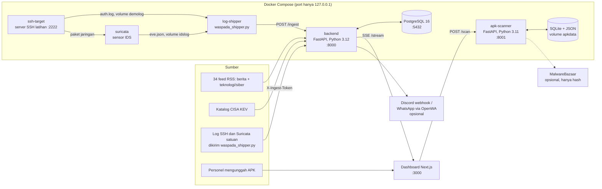
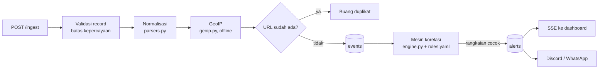
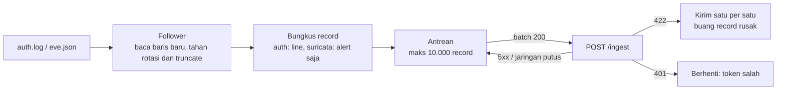
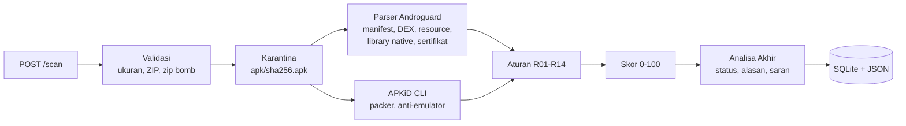

# WASPADA: Arsitektur

**W**ide-**A**rea **S**ignal **P**rocessing for **A**lerting and **D**omain **A**wareness. Sistem peringatan dini siber dengan dua modul: **Pemantauan SIEM** dan **Pemeriksa APK**. Bentuk data dijelaskan di [SCHEMA.md](SCHEMA.md); cara menjalankan ada di [README.md](README.md#instalasi-untuk-kolaborator).

## 1. Gambaran umum

| Layanan | Teknologi | Port | Peran |
|---|---|---|---|
| `db` | PostgreSQL 16 | 127.0.0.1:5432 | Menyimpan event dan alert SIEM |
| `backend` | Python 3.12, FastAPI | 127.0.0.1:8000 | Ingest, normalisasi, GeoIP, korelasi, notifikasi, SSE |
| `apk-scanner` | Python 3.11, FastAPI, Androguard 4.1.4, APKiD 3.2.0 | 127.0.0.1:8001 | Analisis statis APK |
| `ssh-target` | Alpine, OpenSSH | 127.0.0.1:2222 | Server latihan untuk demo; menulis `auth.log` asli ke volume `demolog`. Login berhasil tidak mendapat shell |
| `suricata` | Suricata 8.0.7 | - | Sensor IDS yang berbagi jaringan dengan `ssh-target`; menulis alert ke `eve.json` di volume `idslog` |
| `log-shipper` | Python 3.12, hanya stdlib | - | Membaca `auth.log` dan `eve.json` server latihan seperti `tail -F` dan mengirimnya ke `/ingest` |
| dashboard | Next.js 15, React 19, Tailwind 4, motion, anime.js | 3000 (`npm run dev`) | Landing, `/pemantauan`, `/log`, `/apk` |

## 2. Pemantauan SIEM

1. **Ingest** (`app.py`): record masuk lewat `POST /ingest`. Sumbernya `rss.py` (polling 34 feed setiap 5 menit: 21 media berita dan 13 media teknologi/siber dalam dan luar negeri), `kev.py` (katalog CISA KEV × `assets.yaml`), `replay.py` (skenario demo), atau log yang dikirim langsung.
2. **Normalisasi** (`normalize.py`, `parsers.py`): setiap sumber dipetakan ke satu skema event. Berita dicocokkan ke topik dan kategori dari `topics.yaml`; IP tujuan Suricata dipetakan ke nama aset lewat `assets.yaml`.
3. **GeoIP** (`geoip.py`): event dengan `src_ip` diberi negara dan pemilik jaringan dari DB-IP Lite. Database diunduh saat build image (`geoip_fetch.py`) dan dibaca offline. IP internal dan rentang khusus diberi label, tidak ditebak.
4. **Deduplikasi**: event dengan `url` yang sudah tersimpan dibuang.
5. **Korelasi** (`engine.py`): sliding window per rule dan per `group_by`. Rule (`rules.yaml`) berupa urutan langkah, sehingga satu mesin menangani tiga pola:
   - *threshold*: satu langkah dengan jumlah minimum (mis. ≥5 port dari satu IP dalam 5 menit);
   - *sequence*: langkah berurutan (mis. ≥10 login gagal lalu login berhasil);
   - *cross-source*: langkah dari sumber berbeda (mis. aset rentan KEV → upaya eksploitasi → login berhasil).

   Window dihitung dari timestamp event, bukan jam dinding, sehingga replay demo selalu menghasilkan alert yang sama. Setiap alert membawa teknik MITRE ATT&CK.
6. **Keluaran**: alert disimpan ke PostgreSQL, dikirim ke dashboard lewat SSE tanpa refresh, ke Discord bila `DISCORD_WEBHOOK_URL` diatur, dan (khusus high/critical) ke WhatsApp lewat OpenWA bila `OPENWA_*` dan `WA_ALERT_CHAT` diatur. Pesan WA hanya ringkasan dan tautan dashboard.

**Batasan yang disengaja:** state window disimpan di memori, jadi hilang saat backend restart (ditandai di kode). Cukup untuk skala demo; untuk produksi state dimuat ulang dari tabel `events`.

### Pengirim log (`shipper/waspada_shipper.py`)

Satu file Python tanpa dependensi, dijalankan di server satuan. Baris yang belum diakhiri newline ditahan sampai lengkap. Bila SIEM tidak terjangkau, record menunggu di antrean dan dikirim ulang dengan jeda bertambah.

## 3. Pemeriksa APK

- **APK tidak pernah dipasang atau dijalankan**; semua analisis statis.
- **Isolasi galat per tahap** (pola MobSF): tahap yang gagal dicatat di `tahap_gagal`, tahap lain tetap berjalan.
- **Aturan R01–R14** mencakup pencuri OTP (SMS, Aksesibilitas, overlay, bot Telegram), dropper, packer, judi online, rahasia tertanam, dan upaya menghindari analisis. Detail di [apk-scanner/docs/PRD-v1.2.md](apk-scanner/docs/PRD-v1.2.md).
- **Analisa Akhir** menggabungkan skor, sertifikat penandatangan, cek hash MalwareBazaar (opsional, hanya hash yang dikirim), dan pengelompokan domain.
- Batas waktu analisis 120 detik; container dibatasi 2 GB RAM, 2 CPU, 256 proses.

## 4. Dashboard

| Halaman | Isi | Data |
|---|---|---|
| `/` | Pilihan modul | Statis |
| `/pemantauan` | Statistik, alur korelasi, alert (detail + MITRE + penanganan: status dan catatan analis), arus kejadian, asal IP penyerang | REST `/alerts`, `/events`, `PATCH /alerts/{id}` + SSE `/stream` dari backend |
| `/log` | Statistik log, grafik log per menit, status pengirim per host, aliran baris log live (saring jenis, cari IP/host), asal IP penyerang, cara memasang pengirim | REST `/events?sources=auth,suricata` + SSE `/stream` |
| `/apk` | Unggah APK dan riwayat | `POST /scan`, `GET /scans` dari apk-scanner |
| `/apk/[id]` | Hasil pemindaian dan Analisa Akhir | `GET /scans/{id}` |

Dashboard hanya menampilkan data; semua logika deteksi ada di backend. Arah desain dan aturan gerak ada di [frontend/DESIGN.md](frontend/DESIGN.md).

## 5. Keamanan

| Lapisan | Penerapan |
|---|---|
| Jaringan | Semua port Docker hanya terikat ke `127.0.0.1`; perangkat lain di Wi-Fi tidak bisa menjangkau API atau database |
| Token ingest | Bila `INGEST_TOKEN` diatur, `POST /ingest` wajib membawa header `X-Ingest-Token` yang sama (dibandingkan dengan `hmac.compare_digest`); tanpa itu `401`. Wajib diisi sebelum backend dibuka ke jaringan lain |
| Penanganan alert | Riwayat `handling` hanya bertambah (jejak audit). Belum ada login, jadi riwayat tidak mencatat siapa analisnya dan `PATCH /alerts/{id}` hanya aman selama backend terikat `127.0.0.1` |
| Container log-shipper | Filesystem read-only, log di-mount read-only, semua capability dicabut, `no-new-privileges` |
| Batas kepercayaan | Record `/ingest` dan file APK divalidasi sebelum diproses; URL berita hanya `http`/`https`; nama file dari pengguna dibuang |
| Container scanner | User non-root, kode di-mount read-only, filesystem read-only, semua capability dicabut, `no-new-privileges` |
| Data keluar | Hanya hash APK ke MalwareBazaar (bila kunci diatur), alert ke Discord (bila webhook diatur), dan ringkasan alert high/critical ke WhatsApp lewat OpenWA (bila diatur; berisi rule, host, dan IP, melewati server Meta, tanpa log mentah). IP penyerang tidak dikirim ke layanan GeoIP mana pun |
| Etika | Murni defensif. Token atau URL pelaku yang ditemukan hanya dicatat sebagai bukti untuk dilaporkan, tidak dipakai untuk mengakses sistem pelaku |
| Data demo | Sintetis dan berlabel "Simulasi"; IP penyerang memakai rentang dokumentasi 203.0.113.0/24 |

## 6. Ketergantungan eksternal

| Komponen | Lisensi | Dipakai sebagai |
|---|---|---|
| Androguard 4.1.4 | Apache-2.0 | Library Python (scanner) |
| APKiD 3.2.0 | GPL / komersial | Program terpisah (CLI) |
| maxminddb 3.2.0 | Apache-2.0 | Pembaca database GeoIP |
| DB-IP Lite (country + ASN) | CC BY 4.0 | Database lokasi IP, diunduh saat build |
| CISA KEV | Domain publik (pemerintah AS) | Katalog kerentanan yang dieksploitasi |
| MalwareBazaar (abuse.ch) | Ketentuan layanan abuse.ch | API cek hash, opsional |
| Next.js, React, motion, anime.js | MIT | Dashboard |
